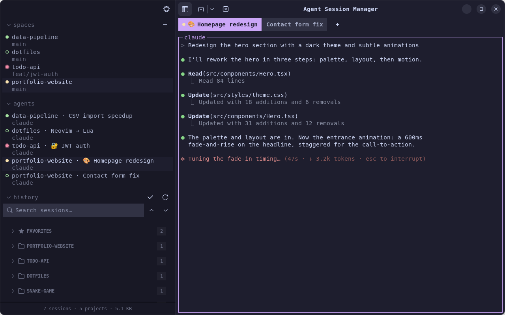

# Agent Session Manager

[](https://github.com/r4nd3l/agent-session-manager/actions/workflows/ci.yml)
[](https://pypi.org/project/agent-session-manager-gtk/)
[](https://aur.archlinux.org/packages/agent-session-manager)
[](https://github.com/r4nd3l/agent-session-manager/releases/latest)

Native GTK4/libadwaita terminal workspace for AI coding agents. Run [Claude Code](https://claude.com/claude-code) and [Cursor](https://cursor.com) side by side in spaces, tabs, and split panes; see at a glance which agent is working, blocked, or done; and resume any past session.

📖 **[Documentation](https://r4nd3l.github.io/agent-session-manager/)**

> **Unofficial community tool.** An independent community project, not affiliated with or endorsed by any agent vendor (including Anthropic) or by herdr.
> It never modifies your agents' own session data — all app state lives in its own config file.



The workspace model and look are inspired by [herdr](https://herdr.dev), a terminal workspace manager for coding agents.

## Features

- **Spaces**: every project folder with open tabs is a space, listed in the sidebar with its git branch. Tabs belong to their space; the tab strip's **+** starts another agent in the same folder.
- **Agents & states**: every running agent with a status dot — **working**, **blocked** (waiting on an approval or a question), **done** (finished while you weren't looking), or **idle** — rolled up to its space. Detected from Claude Code's terminal title and screen and from Cursor's prompts (a simplified port of herdr's detection rules). Desktop notifications fire when an agent you aren't watching finishes or needs you.
- **Split panes**: shell panes next to the agent, split right or down, with focus moves, zoom, and close.
- **`Ctrl+B` prefix** with herdr's default keys for panes, tabs, spaces, the sidebar, and preferences; `Ctrl+B ?` lists them. **Go to agent** (`Ctrl+B g`) jumps to any running agent, filterable by state.
- **History**: every past session on disk (for Claude Code, under `~/.claude/projects/`), grouped by project with a **Favorites** group, a **search box**, waiting / interrupted badges, live updates, and a quick switcher (`Ctrl+Shift+K`). Click a session to resume it in a tab.
- **Names, favorites, emoji**: rename sessions, star them, and put one emoji on a tab (`Ctrl+.` or click the tab's emoji). All of it lives in `~/.config/agent-session-manager/state.json`.
- **Terminals**: each tab is an embedded **VTE terminal** running your `$SHELL` with the agent's command, in the project folder. Closing a tab asks the agent to exit cleanly (Claude Code's `/exit`) first. In-terminal search (`Ctrl+Shift+G`); `Shift+Enter` inserts a newline in the agent's prompt.
- **Right-click a session** for the full action set: open, open in [Ghostty](https://ghostty.org), fork, continue in chat, rename, favorite, **details** (messages/models/tokens, a peek at recent messages, MCP servers and usage), replay, copy session ID, export as Markdown, reveal the transcript, hide, trash, or delete permanently. **Select mode** handles many sessions at once.
- **Look**: a terminal-workspace style in Catppuccin by default (matching herdr), with Tokyo Night, Gruvbox, Nord, Dracula, and more as variants coloring the whole window — or the **Classic (Adwaita)** style.
- **Sidebar sections** (spaces, agents, history) fold with a click on their title and can be switched off in Preferences.
- **Also**: multiple windows, Claude Code and Cursor side by side, advanced new-session options (model, permission mode, extra directories, continue), an MCP servers browser, native streaming chat with permission cards, and session replay.

### Keyboard shortcuts

| Shortcut | Action |
|---|---|
| `Ctrl+B`, then a key | Prefix commands (`v`/`-` split, `hjkl` move, `z` zoom, `x` close pane, `c` new agent, `n`/`p` tabs, `g` go to agent, `?` help…) |
| `Ctrl+Shift+T` | New session |
| `Ctrl+Shift+N` | New window |
| `Ctrl+Shift+W` | Close current tab |
| `Ctrl+Tab` / `Ctrl+PgDn` | Next tab in this space (with `Shift` / `PgUp`: previous) |
| `Ctrl+Shift+K` | Quick switcher (jump to any session) |
| `Ctrl+Shift+F` | Focus the history search |
| `Ctrl+.` | Pick an emoji for the current tab |
| `Ctrl+Shift+E` | Toggle 😊 on the current tab |
| `Ctrl+Shift+C` / `Ctrl+Shift+V` | Copy / paste in terminal |
| `Ctrl+Shift+G` | Find in terminal |
| `F9` | Toggle sidebar |
| `Ctrl+,` | Preferences |

## Requirements

Python ≥ 3.10, GTK 4, libadwaita ≥ 1.5, VTE (GTK 4 build), PyGObject — from your distro's packages:

```bash
# Ubuntu / Debian
sudo apt install python3-gi gir1.2-gtk-4.0 gir1.2-adw-1 gir1.2-vte-3.91

# Fedora
sudo dnf install python3-gobject gtk4 libadwaita vte291-gtk4

# Arch
sudo pacman -S python-gobject gtk4 libadwaita vte4
```

Plus a supported agent's CLI on your `PATH` — the [`claude` CLI](https://claude.com/claude-code) and/or [`cursor-agent`](https://cursor.com).

> Installing with `pipx`? PyGObject comes from the system, so use
> `pipx install --system-site-packages agent-session-manager-gtk`.

## Install

**Ubuntu — PPA:**

```bash
sudo add-apt-repository ppa:matemiller992/agent-session-manager
sudo apt update && sudo apt install agent-session-manager
```

**Arch — AUR:** `yay -S agent-session-manager`

**Any distro — pipx:** `pipx install --system-site-packages agent-session-manager-gtk`

**Debian/Ubuntu — .deb package** (from the [latest release](https://github.com/r4nd3l/agent-session-manager/releases/latest)):

```bash
sudo apt install ./agent-session-manager_*_all.deb
```

Dependencies are pulled in automatically; the app appears in your app grid as "Agent Session Manager".

**From source:**

```bash
git clone https://github.com/r4nd3l/agent-session-manager.git
cd agent-session-manager
python3 -m claude_session_manager
```

Or install the desktop launcher + icon (shows up in the app grid as "Agent Session Manager"):

```bash
./data/install.sh
```

Terminal shortcuts: `Ctrl+Shift+C` copy, `Ctrl+Shift+V` paste.

## Layout

```
claude_session_manager/
├── app.py         # Adw.Application entry point + base CSS
├── window.py      # main window: spaces, tabs, Ctrl+B prefix, actions
├── spaces.py      # spaces / agents sidebar panel and per-space tab strip
├── panes.py       # split panes inside a tab
├── agentstate.py  # working / blocked / idle detection
├── sidebar.py     # the history list
├── store.py       # session discovery off the main thread, file monitors
├── sessions.py    # transcript discovery + statistics
├── providers.py   # per-agent adapters (Claude Code, Cursor)
├── state.py       # persistent app state (names, favorites, hidden, settings)
├── themes.py      # color themes + the terminal-workspace stylesheet
├── prefs.py       # preferences dialog
└── terminal.py    # VTE terminal tab spawning the agent CLI
data/
├── io.github.r4nd3l.AgentSessionManager.desktop   # launcher template
├── icons/io.github.r4nd3l.AgentSessionManager.svg # app icon
└── install.sh                              # install launcher + icon for current user
scripts/
├── build_deb.sh                            # build the .deb package into dist/
└── make_demo_data.py                       # fake sessions for screenshots/demos
```

## Publishing (maintainers)

Releases are one step: **push a `v*` tag**. `.github/workflows/release.yml` then
builds the wheel/sdist and the `.deb`, creates the GitHub Release (with the
`.deb` attached and auto-generated notes), and publishes to
[PyPI](https://pypi.org/project/agent-session-manager-gtk/) via **trusted
publishing** (OIDC — no API tokens).

```bash
# bump version in pyproject.toml / __init__.py / debian/changelog, commit, then:
git tag -a v1.1.0 -m v1.1.0 && git push origin v1.1.0
```

PyPI trusted-publisher setup expects workflow `release.yml` (owner `r4nd3l`,
repo `agent-session-manager`). The AUR and PPA are updated separately
(see `packaging/`).

## Roadmap

- Agents (not just shells) in split panes, with their own state
- Persistent spaces and layouts across restarts
- More provider adapters beyond Claude Code and Cursor
- Flathub
